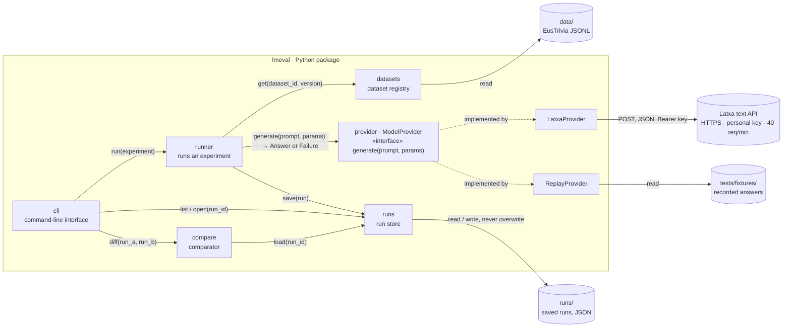

# Component diagram

*Which parts the system has, what each one offers to the others, and where the external services are. Names match the modules in `lmeval/`.*

## The core API between modules

| Interface | Offered by | Used by | What it promises |
|---|---|---|---|
| `generate(prompt, params) → Answer or Failure` | `provider` (ModelProvider) | `runner` | One answer or one failure with a reason. Never raises for a timeout or a refusal. |
| `get(dataset_id, version) → Dataset` | `datasets` | `runner` | The questions of one registered version. |
| `save(run) → run_id`, `load(run_id) → Run`, `list() → [RunSummary]` | `runs` | `runner`, `compare`, `cli` | A saved run is never changed again. |
| `diff(run_a, run_b) → Comparison` | `compare` | `cli` | Per-question pairing by id; refuses different dataset versions. |

## Why this boundary

`ModelProvider` is the replaceable component the course asks for. `ReplayProvider` reads recorded answers and is what tests and the demonstration use. `LatxaProvider` is the only module that knows the network, the key and the rate limit. Which one runs is decided by configuration (`LMEVAL_PROVIDER`), never by editing code.
