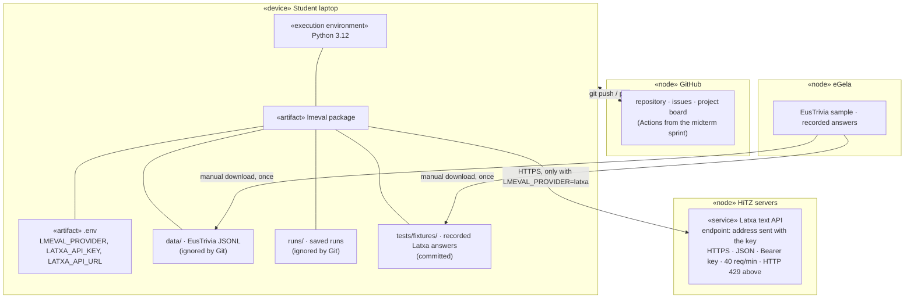

# Deployment diagram

*Where the software runs, and which external services and endpoints it depends on. There is no server and no GPU: everything runs on a laptop and talks to services we do not operate.*

## Notes

- **Offline path.** With `LMEVAL_PROVIDER=replay` nothing leaves the laptop. This is how tests run and how the demonstration is given.
- **Live path.** With `LMEVAL_PROVIDER=latxa` the package calls the Latxa endpoint. The address and the key come from HiTZ with the key request, from 17 November, and live only in `.env`.
- **No other endpoint.** P2 does not use the CLARIAH-EUS OCR or speech services.
